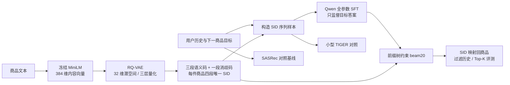

# Generative Recommendation Learning

**从序列推荐到语义 ID 生成：在同一份 Amazon 数据上，搭建、对比并分析 SASRec、TIGER 式召回与 Qwen 全参数 SFT。**

[项目实现与取舍](PROJECT_OVERVIEW.md) · [正式 SFT 报告](experiments/qwen_sft_office2018_20261013/README.md) · [复现与运行](REPRODUCING.md) · [模型参数](07_组合结果统计/模型参数_20261013.json) · [学习知识库](01_知识库/README.md)

## 项目成果

在 **86,713 位用户、25,898 件商品**的共同测试集上，Qwen SFT 的 **Recall@10 = 9.37%**，SASRec 为 **5.76%**，增加 **3.60 个百分点**（相对 +62.49%）；NDCG@10 从 **0.03555** 提升至 **0.07550**。[原始测试记录](experiments/qwen_sft_office2018_20261013/test.json)

这组结果反映本项目不同方案的实测表现。Qwen 的参数规模、预训练、训练预算与硬件均不同于 SASRec；SASRec 使用精确全目录打分，生成模型使用有限 beam 近似检索，因此**不是单变量消融，也不作为论文 SOTA 声明**。

| 方法 | 推荐模型参数量¹ | Recall@10 | NDCG@10 | Recall@20 | NDCG@20 |
|---|---:|---:|---:|---:|---:|
| Popularity | 无神经网络 | 0.008949 | 0.004577 | 0.016572 | 0.006475 |
| SASRec · 最佳第 23 轮 | 1.71M | 0.057650 | 0.035554 | 0.074406 | 0.039775 |
| 小型 TIGER · 梯度码本 SID | 0.328M | 0.049566 | 0.036792 | 0.060637 | 0.039582 |
| 小型 TIGER · EMA 码本 SID | 0.328M | 0.049820 | 0.037539 | 0.057096 | 0.039382 |
| **Qwen2.5-1.5B-Instruct · 全参数 SFT** | **1.545B** | **0.093677** | **0.075496** | **0.108819** | **0.079319** |

¹ 表中参数量仅指在线推荐模型，不含离线 MiniLM 与 RQ-VAE。每人仅一个测试目标，HitRate@K 与 Recall@K 相同。SASRec / TIGER 为 CPU 实验；Qwen 为 A100 40GB 实验。完整记录见 [SASRec](experiments/sasrec_cpu_extend40_20261007.md)、[TIGER 对照](experiments/semantic_retrievers_comparison_20261008.md)、[Qwen SFT](experiments/qwen_sft_office2018_20261013/README.md)。

## 我在项目中做了什么

| 工作 | 实际改动 | 验证与发现 |
|---|---|---|
| 建立可比基线 | 对齐清洗、商品 ID、时序划分、历史过滤；SASRec 增加全目录评测、验证集选模和恢复入口 | 统一 86,713 人测试，替代上游采样候选口径；[数据协议](01_知识库/03_数据与评测/数据与评测协议.md) |
| 构建离散商品表示 | 冻结 MiniLM 编码；训练三层 RQ-VAE；追加一段碰撞消歧码；增加死码审计与 EMA 对照 | 第一层活跃码字 **84→117**，死码 **172→139**；[量化报告](experiments/rqvae_adam_vs_ema_20261008.md) |
| 打通小型生成召回 | 用四段 SID 训练小型 Transformer，通过商品前缀树约束 beam 检索 | 梯度版 TIGER 的 Recall@10 **低于 SASRec**；保留负向结果，EMA 利用率改善也未转化为全面推荐提升 |
| 将 Qwen 适配为推荐生成器 | 扩展 **1,024 个 SID token**；固定 Q0 初始化；聊天模板输入历史；只监督答案；全参数 SFT | **397,345 个训练位置**，固定 5,000 人验证子集选中第 3,000 步；完成全用户测试 |
| 检查生成与评测细节 | 固定 `sid_beam_v2` 解码配置；导出候选四段 SID 与路径分数；记录代码、数据、权重指纹 | 公开 **33 人 / 660 条候选**；第一段 SID 平均 5.88 种；[候选记录](experiments/qwen_sft_office2018_20261013/candidates_33_users.jsonl) |
| 测量训练吞吐 | 有效 batch=128 不变，短测 microbatch 2→4、累积 64→32 | 更新耗时 **10.92→6.58 秒**，吞吐约 **+66.1%**；仅 2 个计时步，未用于上述正式训练；[原始短测](experiments/qwen_sft_office2018_20261013/batch_benchmark_b4.json) |

基础模型与参考实现保留来源、固定版本及许可证。本项目工作主要是数据与协议统一、适配、对照实验和可核验记录，具体代码边界见[实现说明](PROJECT_OVERVIEW.md)。

## 系统路线

MiniLM 与 RQ-VAE 离线运行，生成器训练时固定 SID 映射。Qwen 学习的是自己的 token embedding 与 Transformer 参数，**不直接使用 RQ-VAE 码本向量作为输入 embedding**。第四段用于唯一性消歧，不是第四层残差量化。

## 模型规模与训练设置

| 组件 | 参数规模 | 主要结构 | 当前使用方式 |
|---|---:|---|---|
| MiniLM | 22.71M | 6 层双向 Transformer；hidden 384；12 头 | 冻结；文本截断 128 token；均值池化 + L2 |
| RQ-VAE | 0.295M | 编码器 384→256→128→32；3×256×32 码本；逆向解码器 | 重构、码本、承诺损失；EMA 版独立对照 |
| SASRec | 1.71M | 2 个因果注意力 Block；hidden 64；2 头 | 最近 20 件商品；BCE 与随机负例 |
| 小型 TIGER | 0.328M | 1 层 Encoder + 1 层 Decoder；hidden 64；2 头 | 从头训练；预测四段 SID |
| Qwen SFT | 1.545B | 28 层 Decoder；hidden 1536；Q/KV 头 12/2；FFN 8960 | 全参数训练；BF16；microbatch 2×累积 64 |

Qwen 扩展后词表为 **152,689**，输入输出 embedding 共享。Q1 主任务训练 1 轮，学习率 5e-5；商品编码器与量化器不参与 SFT 梯度更新。完整结构与精度设置见[模型参数表](07_组合结果统计/模型参数_20261013.json)及[精度说明](01_知识库/05_SFT与生成式推荐/FP32_BF16与本项目精度设置.md)。

## 评测约定与结果边界

- **数据划分：** 用户内按时间排序，最后一件测试、倒数第二件验证、更早部分训练；用户可以出现在多个划分中，预测目标与可见历史按时间隔离。
- **候选范围：** 全部 25,898 件商品，过滤完整已知历史；SASRec 精确打分，TIGER / Qwen 使用 beam20 近似检索。主表不采用“1 正 + 100 负”的采样评测。
- **选模：** SASRec / TIGER 使用其验证集，Qwen 正式训练使用固定 5,000 人验证子集，均按验证 NDCG@10 选模；测试不用于奖励或选模。
- **证据：** 单随机种子、固定商品目录和用户内时序划分；没有线上 A/B 结论。AUC / GAUC 已有代码入口，尚未实测，不填造数值。
- **复用：** SFT 权重保留在私有持久网盘；Git 公开代码、配置、结构参数、结果和指纹。克隆仓库不会获得已训练 Qwen 权重。[权重记录](experiments/qwen_sft_office2018_20261013/model_artifact.json)

## 阅读与复现导航

| 入口 | 内容 |
|---|---|
| [项目实现与取舍](PROJECT_OVERVIEW.md) | 问题、改动、效果、代码位置与仍待验证的问题 |
| [复现与运行](REPRODUCING.md) | 数据下载、CPU 环境、SASRec 检查与训练、生成式运行入口 |
| [01 · 知识库](01_知识库/README.md) | SASRec、语义 ID、SFT 输入输出和梯度原理 |
| [02 · 商品编码](02_商品编码/README.md) | MiniLM 模型 / 分词器与其他编码器版本 |
| [03 · 离散语义 ID](03_离散语义ID/README.md) | 梯度码本、EMA；RQ-KMeans 预留版本 |
| [04 · 推荐生成](04_推荐生成/README.md) | 小型 TIGER 与 Qwen 配置、实现入口 |
| [06 · 每日记录](06_每日效果记录/README.md) / [07 · 组合统计](07_组合结果统计/README.md) | 实验过程、组合结果、模型参数与原始指标 |
| [实验索引](experiments/README.md) / [第三方来源](THIRD_PARTY_NOTICES.md) | 历史报告与来源、许可证、引用 |

代码集中在 `scripts/`，参考源码在 `baselines/`，协议与模型检查在 `tests/`。原始数据、用户映射与训练输出位于 Git 忽略目录。编号 05 暂未使用，保留既有实验路径以便核验历史指纹。

当前已完成 SASRec、两套小型 TIGER 与 Qwen Q1 SFT 的实测对照。后续方向包括商品编码对照、标题对齐与偏好优化；尚未验证的改动不列为已取得的收益。

## 参考与许可

[SASRec](https://github.com/pmixer/SASRec.pytorch) · [TIGER 论文](https://arxiv.org/abs/2305.05065) · [RQ-VAE-Recommender](https://github.com/EdoardoBotta/RQ-VAE-Recommender) · [MiniOneRec](https://github.com/AkaliKong/MiniOneRec) · [OpenOneRec](https://github.com/Kuaishou-OneRec/OpenOneRec)

代码采用 [Apache-2.0](LICENSE)，第三方代码与数据遵循各自许可。本仓库与[推荐系统学习知识库](https://github.com/Tanghaopeng/recommendation-system-learning)配套，侧重实际实现与实验记录。
